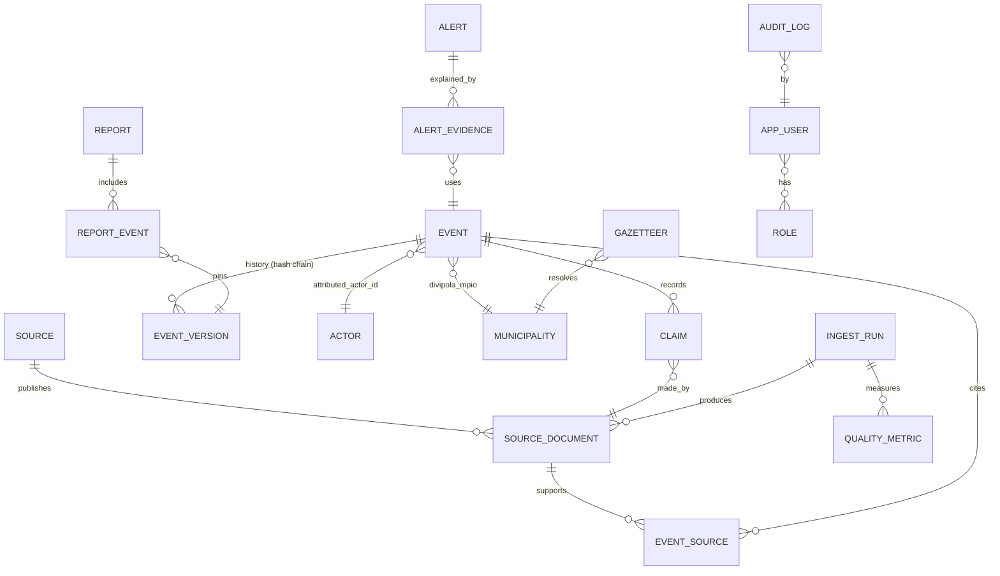

# ERD y diccionario de datos · OTVA v1

Metadatos y esquemas en inglés técnico; textos visibles en español. DDL versionado con Alembic: **no se escribe en Fase 0**; este documento fija el contrato.

## 1. ERD

## 2. Entidades (Fase 1 marca las que se construyen)

**`event`** (Fase 1; cabecera estable) y **`event_version`** (Fase 1; inmutable, una fila por cambio, encadenada por hash).

| Campo | Tipo | Regla |
|---|---|---|
| `event_id` | UUIDv7 | Estable entre versiones |
| `legacy_id` | text | `CO-2026-NNN` de la v0; nunca se reutiliza |
| `version` | int | Monótono por evento |
| `status` | enum | `CANDIDATO, PRELIMINAR, VERIFICADO_EQUIPO, VERIFICADO_INDEPENDIENTE, DESCARTADO, RETRACTADO` |
| `event_type`, `subtype` | enum, text | Taxonomía §3 |
| `legal_label` | text null | Etiqueta jurídica (p. ej., art. 343 CP) **solo con fuente oficial**; nunca automática |
| `t_start`, `t_end`, `t_precision` | timestamptz, timestamptz, enum | `hora, día, semana, mes`; UTC con zona original en `t_tz` |
| `geom` | Point 4326 | Centroide si la precisión es municipio |
| `geo_precision`, `geo_method`, `geo_confidence` | enum, text, real | `exacta, vereda, centro_poblado, municipio, departamento` |
| `divipola_mpio`, `divipola_dpto`, `h3_r7`, `h3_r8` | text | |
| `reported_actor` | text | Lo que dice la fuente |
| `attributed_actor_id` | FK null | NULL = `NO_ATRIBUIDO` |
| `attribution_level`, `attribution_basis` | enum A–E, text | A–D exigen referencia a `event_source`; el sistema impide subir de nivel sin ella |
| `casualties_civil_killed/injured`, `casualties_public_force_killed/injured`, `kidnapped` | int null | NULL = desconocido, **no 0** |
| `modus`, `target_class` | enum | Vocabularios cerrados |
| `sensitivity_class`, `infra_sensitive` | enum, bool | `infra_sensitive` fuerza publicación a municipio + semana |
| `evidence_grade` | text | Admiralty `A1`…`F6` |
| `n_independent_sources` | int | Por `outlet_group_id` distinto y sin copia verbatim |
| `confidence_score`, `confidence_components` | real, jsonb | Fórmula versionada (§4) |
| `claim_flags` | text[] | «solo fuente oficial», «versiones contradictorias», … |
| `legacy_payload` | jsonb | Campos de la v0 sin equivalente (viaje de ida y vuelta) |
| `created_by`, `reviewed_by`, `approved_by` | role ref | **Roles**, no nombres |
| `pipeline_version`, `row_hash`, `prev_hash` | text | SHA-256 de campos canónicos + `prev_hash` |

**`source`** (ficha de fuente), **`source_document`** (Fase 1): `doc_id, source_id, url, canonical_url, fetched_at, published_at, sha256, warc_ref, rfc3161_token, lang, extract (≤ 280), license, public_redistribution, outlet_group_id, admiralty_source, admiralty_info`. El texto completo solo existe en raw, nunca en la base pública.
**`event_source`** (Fase 1): `event_id, doc_id, stance (supports|contradicts|context), span_offsets`.
**`claim`** (Fase 1): `claim_id, event_id, doc_id, field, value, stance`; registra cada afirmación distinta (p. ej., muertos según cada fuente) sin promediar.
**`actor`** (Fase 1): `actor_id, canonical_name, aliases[], actor_type, valid_from, valid_to, designation_source`. Sin individuos.
**`municipality`** (Fase 1, DIVIPOLA) y **`gazetteer`** (Fase 1 nacional por municipio; veredas en pilotos): `alt_name, divipola, source, valid_from, valid_to`.
**`ingest_run`, `quality_metric`** (Fase 1). **`audit_log`** (Fase 1; solo adición; `id, ts, actor_role, action, object, detail_hash, prev_hash, signature`). **`app_user`, `role`** (Fase 2). **`alert`, `alert_evidence`** (Fase 3). **`report`, `report_event`** (Fase 2: el boletín fija la versión de cada evento citado, para que una retractación pueda avisar). **`api_key`** (Fase 2).

**Hash chain.** `row_hash = SHA256(canonical_json(campos) ‖ prev_hash)`, con serialización canónica (claves ordenadas, UTF-8 NFC, sin espacios). Reproducibilidad: misma entrada + mismo `pipeline_version` ⇒ mismo `row_hash`; los campos con marca de tiempo de proceso se excluyen del hash.

## 3. Taxonomía v1.0 (cerrada, versionada)
Etiqueta analítica; **no** es calificación jurídica. Toda categoría exige fuente que describa el hecho; si hay duda entre dos, se elige la menos específica y se marca `claim_flags`.

| Código | Categoría | Definición operativa | Incluye | Excluye |
|---|---|---|---|---|
| EXP | Ataque con explosivo | Detonación o lanzamiento intencional de artefacto explosivo contra personas o bienes | Carro bomba, granada, cilindro, moto bomba | Minas (MIN); drones (DRN) |
| DRN | Ataque con dron o artefacto aéreo | Uso de aeronave no tripulada para lanzar explosivos o atacar | Drones armados o kamikaze | Dron solo de vigilancia |
| HOS | Hostigamiento/asalto a instalación | Disparos o ataque a sede de fuerza pública o institucional | Estaciones, bases, alcaldías | Emboscada en vía (EMB) |
| EMB | Emboscada | Ataque por sorpresa a personal en desplazamiento | Patrullas, convoyes | Combate sostenido iniciado por la fuerza pública (CMB) |
| CMB | Combate | Enfrentamiento armado entre dos o más fuerzas organizadas | Entre fuerza pública y GAO, o entre GAO | Ataque unilateral |
| SEC | Secuestro | Retención de una o más personas contra su voluntad (según fuente oficial o medios con fuente) | Retenciones de uniformados o civiles | Retenciones breves en retén informal sin cobro, salvo que fuente oficial las califique |
| EXT | Extorsión masiva/boleteo | Exigencia coercitiva de pagos a comunidad o sector | Panfletos, boleteo colectivo | Extorsión individual |
| PAR | Paro armado o confinamiento | Restricción impuesta de movilidad a una comunidad o región | Paro armado, confinamiento | Cierre de vía por protesta |
| DES | Desplazamiento forzado | Salida forzada de personas por hechos de violencia, con cifra de la fuente | Masivo (≥ 50 personas o 10 familias, criterio de la fuente oficial) | Desplazamiento por desastres |
| MAS | Masacre | Homicidio de **3 o más** personas indefensas en un mismo hecho (criterio operativo de varias entidades; adoptado aquí, **PENDIENTE de validar**) | Con fuente oficial o de seguimiento | Muertes en combate |
| AMC | Amenaza colectiva | Amenaza dirigida a un grupo, comunidad o institución | Panfletos amenazantes | Amenaza individual |
| INF | Atentado a infraestructura | Daño a infraestructura energética, vial, petrolera o TIC | Torres, oleoductos, puentes | Infraestructura militar (HOS). **Siempre `infra_sensitive`** |
| ASE | Asesinato selectivo | Homicidio dirigido contra persona o grupo identificable por su rol | Líderes, funcionarios, uniformados fuera de combate | Sin nombrar a la víctima en publicación |
| MIN | Minas y artefactos explosivos improvisados | Activación o hallazgo de mina antipersonal o AEI | Víctimas por mina | Ataque con explosivo lanzado (EXP) |

## 4. Fórmula de confianza `confidence_score` v0.1 (propuesta, se publica)
`C = 0,35·F + 0,30·I + 0,20·K + 0,15·O` con F = fiabilidad media de fuentes (Admiralty A=1,0 … F=0), I = min(1, n_fuentes_independientes/3), K = consistencia espacio-temporal (1 si fechas y municipio coinciden en todas), O = 1 si hay fuente oficial, 0 si no. Pesos **provisionales**: se calibran con el conjunto de oro antes de publicarlos como definitivos. Sin interpretación probabilística.

## 5. Mapeo v0 → v1 (migración sin pérdida)
| Campo v0 | v1 |
|---|---|
| `id` | `legacy_id` |
| `fecha`, `hora` (franja: Tarde, …) | `t_start`/`t_precision = día`; franja en `legacy_payload` |
| `depto`, `mpio` | `divipola_dpto`, `divipola_mpio` (tabla de equivalencia a construir con DIVIPOLA; PENDIENTE) |
| `lat`, `lon`, `prec_coord` («Municipal aproximada») | `geom`, `geo_precision = municipio` |
| `tipo`, `mod` (texto libre) | `event_type`/`modus` por tabla de mapeo **revisada a mano** + texto original en `legacy_payload` |
| `clase` («Presunto acto terrorista (clasificación analítica provisional)») | `legal_label` **no** se llena; el texto va a `legacy_payload.clase` |
| `autor`, `grupo`, `atrib`, `evidencia` | `reported_actor`, `attributed_actor_id`, `attribution_level`, `attribution_basis` |
| `m_civ`, `m_fp`, `h_civ`, `h_fp` | `casualties_*`; `kidnapped` = NULL (la v0 no lo tiene) |
| `objetivo` | `target_class` |
| `danos`, `eco`, `desplaz`, `servicios`, `h_nota` | `legacy_payload` |
| `estado` («Preliminar») | `status = PRELIMINAR` |
| `discrepancia` | `claim` + `claim_flags` |
| `fuentes[]` | `source_document` + `event_source` (los hashes de captura se generan al archivar; para eventos históricos, `fetched_at` = fecha real de captura o NULL con aviso) |
| `actualizacion` | `legacy_payload` |
| `excluded`, `context` | tablas `excluded_record`, `context_note` (sin pérdida) |

**Riesgo conocido.** La v0 no archivó contenido de las fuentes: los 42 eventos históricos no tienen `sha256` ni sello de tiempo de captura. El criterio «100 % con fuente archivada» se cumple para eventos **nuevos**; los históricos se marcan `archive_status = legacy_unarchived` y se archivan cuando la fuente siga disponible.
